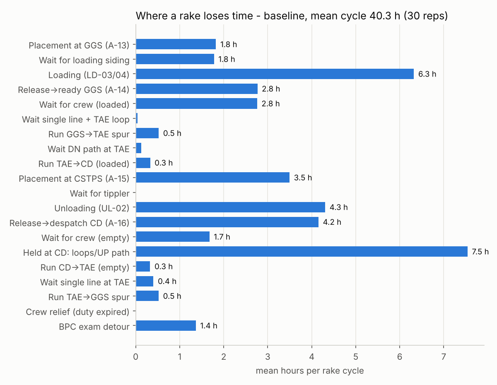

# IE305 RakeFlow - coal rake cycle simulation, Ghugus-Tadali-CSTPS

**The model:** open [`model/RakeFlow/RakeFlow.alp`](model/RakeFlow/RakeFlow.alp) in AnyLogic 8.9.9 (free PLE edition works)
and run the *Simulation* experiment. How it works, what was verified and the results are in
[`model/README.md`](model/README.md); the problem statement and every input with its source is in
[`docs/MODEL_BRIEF.md`](docs/MODEL_BRIEF.md).



## Submission contents (IE305)

| Required | Where |
|---|---|
| AnyLogic model | `model/RakeFlow/RakeFlow.alp` (AnyLogic 8.9.9 PLE): Simulation, Replications30, E1_FleetSize (4-20 rakes), E2toE7_Scenarios (scenarios 0-18) |
| Support files - data collection | `research/` (15 sourced notes + `timetable_tadali_chandrapur.csv`, 115 trains), `data/RakeFlow_Parameter_Sheet.xlsx`, `data/templates/` (8 field-data templates), `docs/Data_Request_Letter_CR_WCL.md`, `docs/MODEL_BRIEF.md`, `scripts/build_param_sheet.py` |
| Support files - analysis | `model/harness/` (same Java run outside AnyLogic, invariant checks, `run_experiments.py`, `key_experiments.py`, `plots.py`), `model/build/` (generator), `model/results/` (`key_experiments.md/.csv`, `summary_tables.md`, `runs_all.csv`, figures) |
| Presentation slides | **`presentation/RakeFlow_Final_Presentation_v2.pptx`** (18 slides: situation, goal/KPIs, how the trains work, data, distributions, model, 4 experiments + 2x2x2, scorecard; built by `build_deck_v2.js`); shorter v1 `RakeFlow_Final_Presentation.pptx`; proposal deck as submitted: `presentation/Coal_Rake_Cycle_IE305_initial_proposal.pptx` |

No Central Railway / WCL records were received; every input is a public source or a flagged assumption (A-01..A-29).

Project folder layout

```
data/
  RakeFlow_Parameter_Sheet.xlsx   every model input: value, distribution, source, confidence
  templates/                       one CSV per data item the team collects (first row is an example - delete it)
  raw/                             drop downloaded PDFs / scraped files here, untouched
  clean/                           cleaned CSVs produced by scripts/
research/                          public-source findings, one markdown file per topic, every number has a URL
docs/
  Data_Request_Letter_CR_WCL.md    draft letter to Sr DOM Nagpur, Sr DME, WCL Wani Area, CSTPS
scripts/
  build_param_sheet.py             rebuilds the parameter workbook from the research files
model/                             AnyLogic 8.9.9 model (model/RakeFlow/RakeFlow.alp) + generator, test harness, results
```

## What we know (public sources, 13 Oct 2026)

- Ghugus (GGS) - Tadali (TAE): 14.11 km single line, no intermediate station, electrified, goods only.
  Doubling sanctioned Jul 2026, Rs 228 crore, +4.5 MTPA (about 3 rakes/day).
- Main line at Tadali/Chandrapur: ~41 passenger trains/day (21 southbound, 20 northbound).
  Southbound quiet window 20:30-06:20; worst 12:58-13:41. Line utilisation 145% UP / 163% DN.
- Ghugus sidings load roughly 7-8 coal rakes/day (2018 figure; plan 9-10). Loading method unconfirmed (likely CHP/pay-loader).
- CSTPS: 2920 MW, needs 47.8 kt/day at 85% PLF, actually burns ~33 kt/day, receives 6-10 rakes/day by rail; 5 wagon tipplers.
- Norms: loading free time 3 h; unloading free time 7 h; demurrage Rs 150/wagon/h; BPC 6000 km / 30 days,
  exam 8 h daylight only; crew 9 h (+2 h with notice, 11 h cap).
- Rake: 58 BOXN wagons, ~3900 t.

## What we still need (see Data_Gaps sheet)

Loops at both ends, sectional speed, loading method and time at Ghugus, crew booking point,
BPC base depot, CSTPS actual unloading hours, 90-day lateness per passenger train, 90-day CEA
daily receipts, and ideally a few weeks of rake-level logs.

## Next steps

1. Send the data request letter (docs/) to the four recipients.
2. Scrape 90-day lateness for the 115 trains (etrain.info history) into data/templates/TT_lateness.csv.
3. Download 90 CEA daily coal PDFs (URL pattern in research/cstps_coal_demand.md) into data/raw and parse CSTPS rows.
4. Start Phase 1 model (single line + Tadali merge) in model/ using the parameter sheet values.
